# Gestor de Películas

Aplicación web para administrar una colección personal de películas, construida con **TypeScript** siguiendo una **arquitectura MVC** y persistencia en `localStorage`.

### Base (Laboratorio #2)
- Registrar, editar y eliminar (con confirmación) películas: título, año y género.
- Marcar una película como vista o pendiente.
- Buscar por título o género.
- Persistencia automática en `localStorage`.

### Nuevo en el Parcial 2
- **RF-01** Calificación en estrellas (1 a 5) y comentario opcional por película.
- **RF-04** Filtros combinables: texto + género + **año** + estado (todas/vistas/pendientes).
- **RF-05** Ordenar por título (A-Z), año (más reciente) o calificación (mayor a menor).
- **RF-07** Pestaña **Resumen** con estadísticas: total, vistas, pendientes y promedio de calificación.
- **RF-08** Recomendaciones: películas pendientes calificadas con 4 o 5 estrellas.
- **RF-09** Promedio de calificaciones de toda la colección.
- **Reto adicional**: Top 5 de mejores películas según calificación.
- **Validaciones avanzadas**: calificación entre 1 y 5, comentario máx. 240 caracteres, y **bloqueo de duplicados** (mismo título + mismo año), tanto al registrar como al editar.
- **Migración automática**: si ya tenías datos guardados con el Laboratorio #2, se migran solos a la nueva versión (calificación por defecto 3★) sin perder tu colección.

## Arquitectura

El proyecto sigue estrictamente el patrón **MVC**


```
gestor-peliculas/
├── index.html
├── package.json
├── tsconfig.json
├── src/
│   ├── main.ts
│   ├── models/
│   │   ├── Pelicula.ts
│   │   └── PeliculaModel.ts
│   ├── views/
│   │   └── PeliculaView.ts
│   ├── controllers/
│   │   └── PeliculaController.ts
│   ├── services/
│   │   └── StorageService.ts
│   └── styles/
│       └── styles.css
└── README.md
```
## Validaciones implementadas

- **Título**: obligatorio, máximo 120 caracteres.
- **Año**: entero entre 1888 y el año actual + 1.
- **Género**: debe pertenecer a la lista predefinida.
- **Calificación**: entero entre 1 y 5 estrellas (obligatoria).
- **Comentario**: opcional, máximo 240 caracteres.
- **Duplicados**: no se permite registrar (ni editar hacia) una combinación de título + año ya existente.

Los errores se muestran junto a cada campo del formulario y como aviso tipo "toast".


## Decisiones de diseño

- **PeliculaModel** separa la lógica de colección (filtrar, ordenar, estadísticas) de la entidad `Pelicula`, que solo conoce sus propios datos y validaciones - así el Controller nunca manipula el arreglo de películas directamente.
- Las **estrellas** del formulario son botones accesibles (`aria-label` por valor); el `Controller` solo recibe un número de 1 a 5, nunca manipula el DOM de las estrellas.
- La pestaña **Resumen** reutiliza los mismos datos del `PeliculaModel` sin duplicar estado: se recalcula cada vez que cambia la colección o se entra a esa pestaña.
- El diseño se mantiene **minimalista** (blanco/negro, líneas finas, sin sombras ni bordes redondeados) en todas las vistas nuevas, siguiendo la estética ya definida para el proyecto.


## Cómo ejecutar el proyecto

Requiere [Node.js](https://nodejs.org/) 18 o superior.

```bash
# 1. Instalar dependencias
npm install

# 2. Levantar el servidor de desarrollo
npm run dev
```

Luego abre la URL que indica la terminal (normalmente `http://localhost:5173`).

## Evidencia de desarrollo
 
Capturas del proceso y del funcionamiento de la aplicación (`imgs/1.png` a `imgs/11.png`).
 
<details>
<summary><strong>Ver las 11 capturas</strong> (clic para expandir)</summary>
<br>
<table>
  <tr>
    <td align="center" width="25%">
      <a href="imgs/1.png">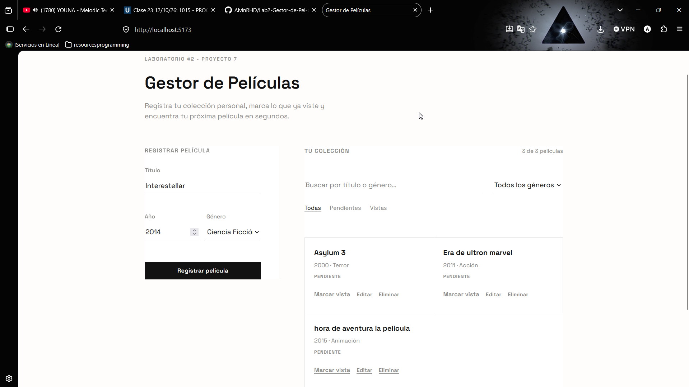</a>
      <br><sub>1</sub>
    </td>
    <td align="center" width="25%">
      <a href="imgs/2.png">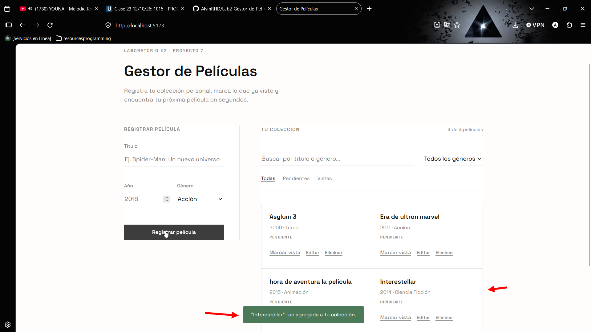</a>
      <br><sub>2</sub>
    </td>
    <td align="center" width="25%">
      <a href="imgs/3.png">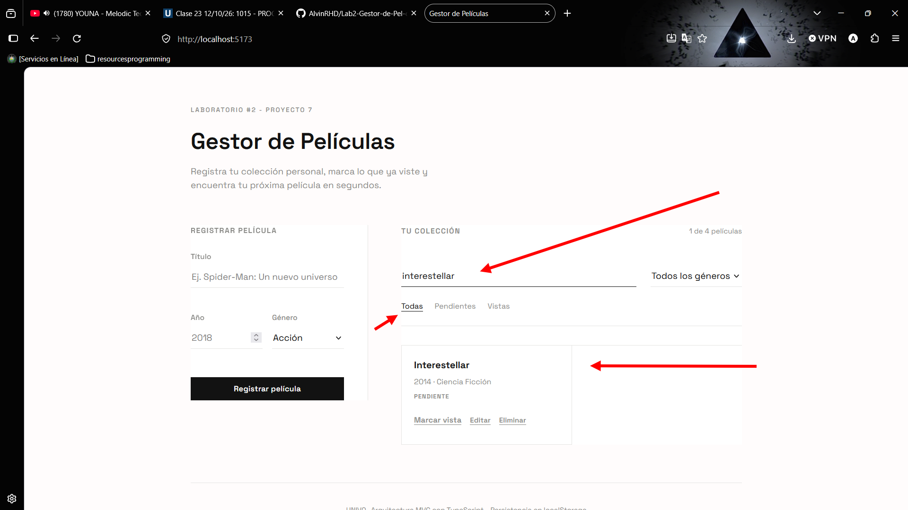</a>
      <br><sub>3</sub>
    </td>
    <td align="center" width="25%">
      <a href="imgs/4.png">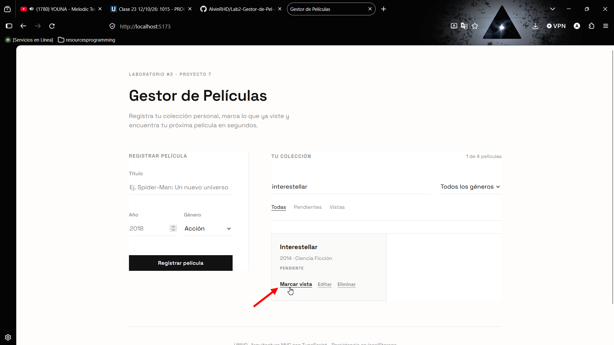</a>
      <br><sub>4</sub>
    </td>
  </tr>
  <tr>
    <td align="center">
      <a href="imgs/5.png">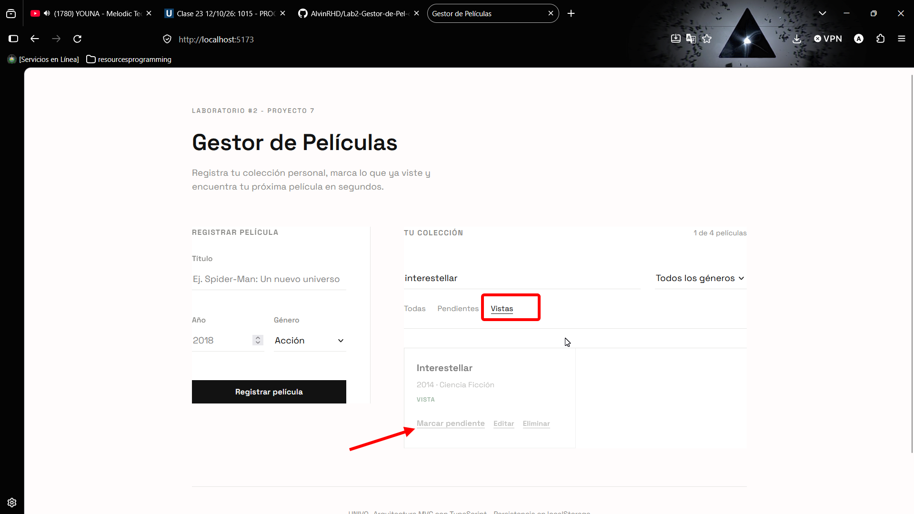</a>
      <br><sub>5</sub>
    </td>
    <td align="center">
      <a href="imgs/6.png">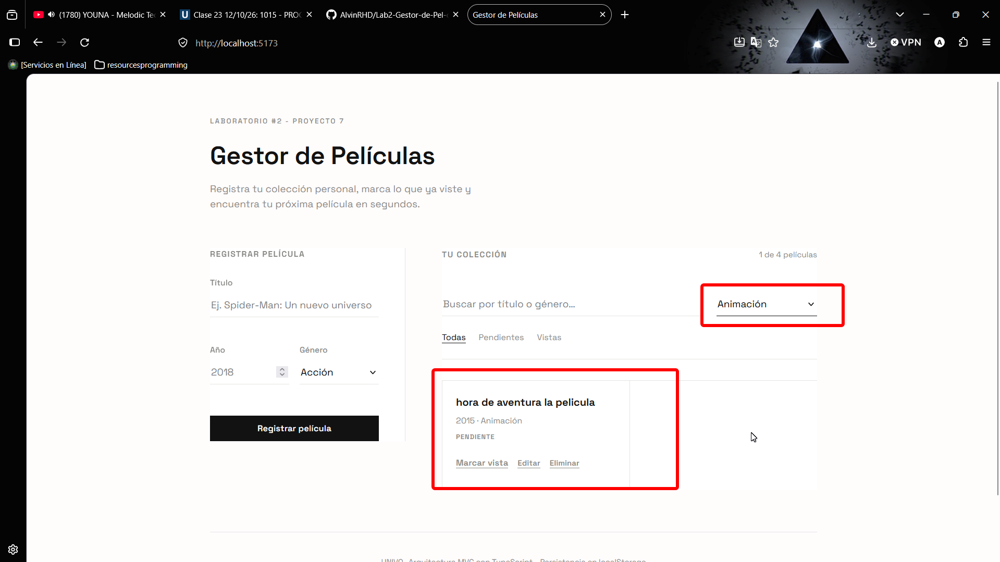</a>
      <br><sub>6</sub>
    </td>
    <td align="center">
      <a href="imgs/7.png">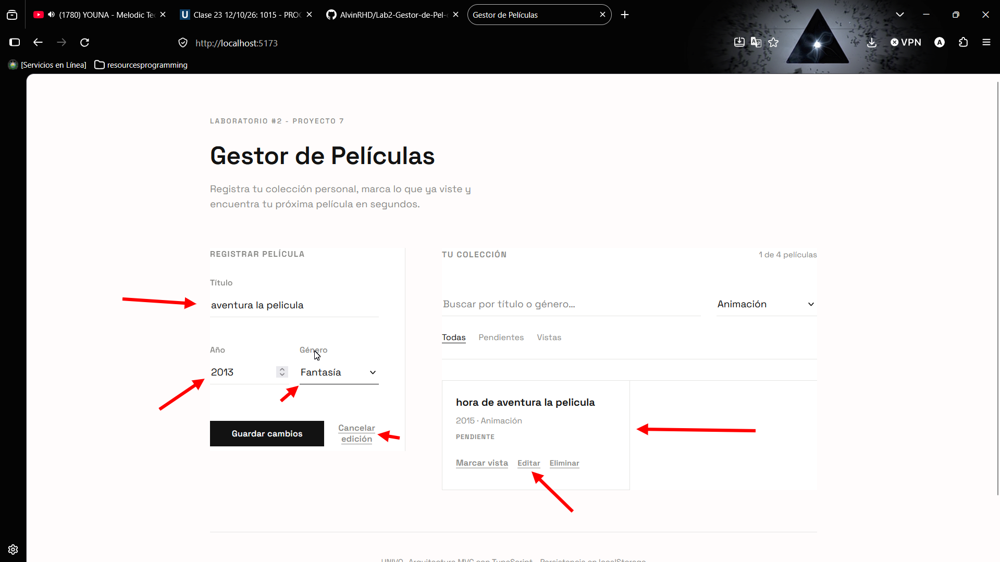</a>
      <br><sub>7</sub>
    </td>
    <td align="center">
      <a href="imgs/8.png">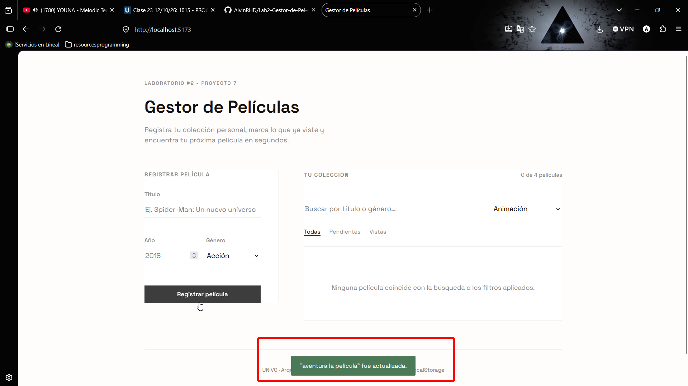</a>
      <br><sub>8</sub>
    </td>
  </tr>
  <tr>
    <td align="center">
      <a href="imgs/9.png">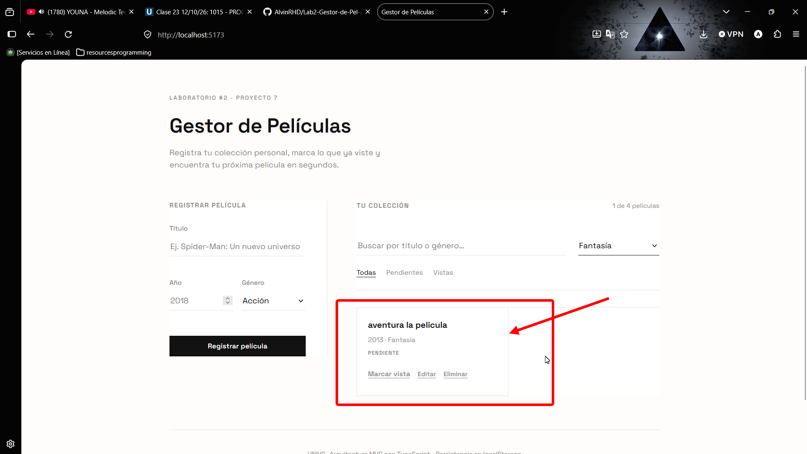</a>
      <br><sub>9</sub>
    </td>
    <td align="center">
      <a href="imgs/10.png">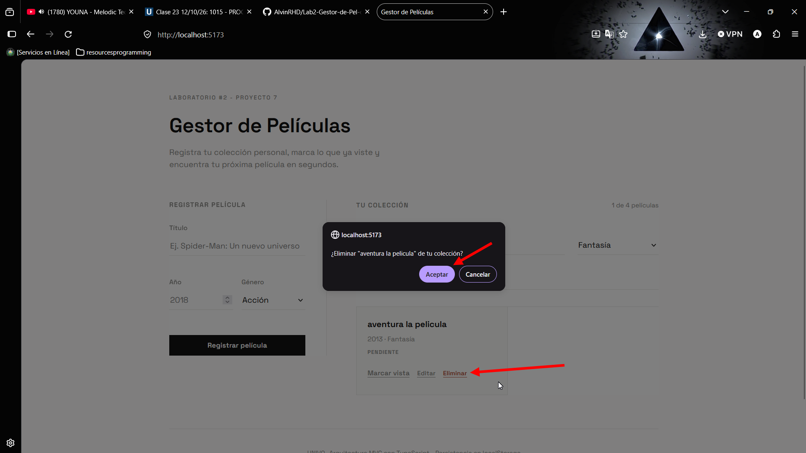</a>
      <br><sub>10</sub>
    </td>
    <td align="center">
      <a href="imgs/11.png">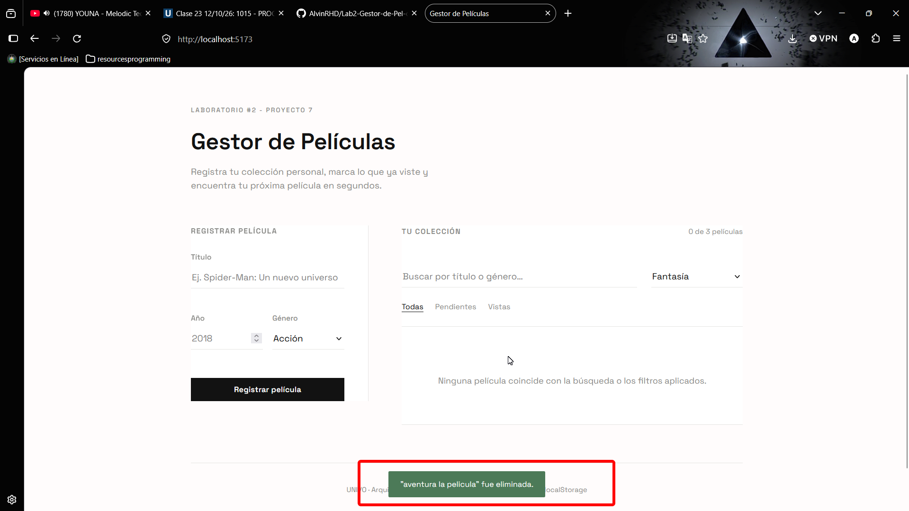</a>
      <br><sub>11</sub>
    </td>
    <td></td>
  </tr>
</table>
</details>


